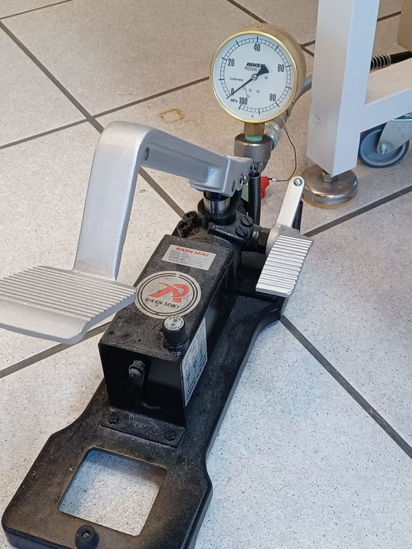
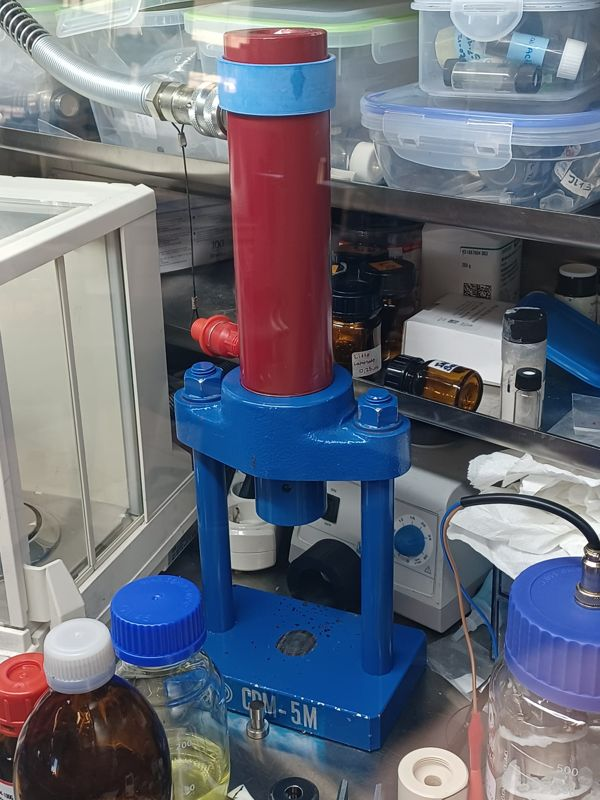

# AC-Impedanzzelle (EIS)

Diese Zelle misst die **Ionenleitfähigkeit** eines Sulfid- oder Halogenid-Festelektrolyt-Presslings zwischen zwei blockierenden Edelstahlelektroden. Führen Sie die Schritte 1–9 in der Glovebox durch.

| | |
|---|---|
| **Teile** | 2 Edelstahlplatten · 2 Edelstahl-Stromableiter (ein langer, ein kurzer) · 2 Silikondichtungen · Zellkörper aus Polycarbonat · 2 Isolatoren · kurze M4-Schrauben · lange 4-mm-Schrauben · Elektrolyt-Pressling |
| **Matrizen** | Ø 6 mm (20–30 mg Pulver) oder Ø 10 mm (80–100 mg Pulver) |
| **Gerät** | [PARSTAT MC · PMC-2000 mit VersaStudio](../instruments/potentiostat.md) |
| **Auswertung** | [EIS-Datenanalyse](../analysis/eis-analysis.md) mit [EIS Studio](https://zacharyslate.github.io/eis-studio/) |

## Vorführung { #demonstration }

--8<-- "eis-cell.svg"

1. **Matrize tarieren.** Setzen Sie den kurzen Pressstempel unten in die Matrize, stellen Sie die Matrize auf die Waage und tarieren Sie (auf null).
2. **Pulver zugeben.** Geben Sie das Elektrolytpulver vorsichtig in die Matrize: **20–30 mg** für die Ø-6-mm-Matrize, **80–100 mg** für die Ø-10-mm-Matrize. Notieren Sie die Masse.
3. **Langen Stempel einsetzen** auf das Pulver.
4. **Pressling pressen.** Stellen Sie die Matrize mittig in die Presse und üben Sie **4 MPa (Manometer)** für **1 min** aus.
5. **Pressling entnehmen.** Drehen Sie die Matrize auf dem Stahlsattel um und drücken Sie die Matrize mit der Presse von den Stempeln. Der Pressling fällt in den Sattel.
6. **Zelle beladen.** Setzen Sie den langen Stromableiter unten in die Polycarbonatzelle, überführen Sie den Pressling in die Bohrung und setzen Sie den kurzen Stromableiter oben ein. **Jeder Stromableiter braucht seine Silikondichtung.**
7. **Verdichten.** Stellen Sie die beladene Zelle mittig in die Presse und erhöhen Sie den Druck langsam: **18 MPa (Manometer) für die Ø-10-mm-Zelle** oder **7,5 MPa (Manometer) für die Ø-6-mm-Zelle**, für **3 min**.
8. **Komplette Zelle aufbauen.** Fügen Sie Stahlplatten, Isolatoren und Schrauben wie in der Zeichnung hinzu.
9. **Ausrichten.** Der Abstand zwischen den äußeren Stahlplatten muss auf allen Seiten gleich sein (**D1 = D2**). Ziehen Sie alle Muttern nur **handfest** an.
10. **Potentiostat anschließen.** Verwenden Sie eine Zwei-Elektroden-Verbindung: **WE (grün) + SE (grau)** an eine Platte, **CE (rot) + RE (weiß)** an die andere. Die Zelle ist symmetrisch, die Polarität spielt keine Rolle.
11. **Equilibrieren und messen.** Lassen Sie die Zelle **mindestens 45 min** eine konstante Temperatur erreichen und führen Sie dann potentiostatische EIS durch (ein Durchlauf dauert etwa 30 s – 1 min).
12. **Bei jeder Temperatur wiederholen**: 40, 60, 80, 100 und 120 °C, mit mindestens 45 min Wartezeit pro Stufe.

## Die Presse und die Druckumrechnung { #press }

<figure markdown>
{ loading=lazy }
<figcaption>Riken-Seiki-Fußpumpe mit 0–100-MPa-Manometer: Es zeigt den Öldruck, nicht den Druck auf Ihr Pellet</figcaption>
</figure>

<figure markdown>
{ loading=lazy }
<figcaption>Presse CDM-5M: Der Zylinder oben drückt den Stempel nach unten auf das Werkzeug oder die Zelle, die auf der Grundplatte stehen</figcaption>
</figure>

Das Manometer der Fußpumpe zeigt den **Öldruck** im Zylinder. Die Kraft entsteht, weil dieser Druck auf den Kolben des Zylinders wirkt, die **40-mm-Kolbenstange**; der 45-mm-Kopf gibt die Kraft nur an den Stempel weiter. Der Druck im Pellet ist diese Kraft geteilt durch die Pelletfläche:

*F* = *P*g × π *d*² / 4 &nbsp;&nbsp;·&nbsp;&nbsp; *P*p = *F* / (π *D*² / 4) = *P*g × (*d* / *D*)² &nbsp;&nbsp;·&nbsp;&nbsp; *P*g = *P*p × (*D* / *d*)²

*d* = Durchmesser der Kolbenstange (40 mm), *D* = Durchmesser des Presswerkzeugs (Pellets). Mit *d* = 40 mm gilt **1 MPa am Manometer = 1,26 kN (0,13 t)**.

| Werkzeug-Ø | Pelletfläche | Pellet ÷ Manometer | 4 MPa Manometer (Pellet formen) | Laboreinstellung für die Zelle |
|---|---|---|---|---|
| 6 mm | 28.3 mm² | × 44.4 | 178 MPa | 7,5 MPa Manometer → **333 MPa** (9,4 kN) |
| 10 mm | 78.5 mm² | × 16.0 | 64 MPa | 18 MPa Manometer → **288 MPa** (22,6 kN) |

**Rückwärts:** Um ein Ø-10-mm-Pellet mit 375 MPa zu pressen, stellen Sie am Manometer 375 × (10/40)² = **23,4 MPa** ein; für Ø 6 mm 375 × (6/40)² = **8,4 MPa**.

<label>Stangen-Ø (mm)<input type="number" data-pc="shaft" value="40" min="1" step="0.1"></label>
<label>Werkzeug-Ø (mm)<input type="number" data-pc="die" value="10" min="1" step="0.1" list="pc-dies"></label>
<label>Manometer (MPa)<input type="number" data-pc="gauge" value="18" min="0" step="0.1"></label>
<label>Druck auf das Pellet (MPa)<input type="number" data-pc="pellet" min="0" step="1"></label>
<label>Kraft<input type="text" data-pc="force" readonly></label>

<datalist id="pc-dies"><option value="6"><option value="10"></datalist>

!!! warning "Bevor Sie sich auf die Zahlen verlassen"
    - Der Kolbendurchmesser unseres Zylinders beträgt **40 mm** (bestätigt). Für eine andere Presse oder einen anderen Zylinder geben Sie dessen Kolbendurchmesser im Rechner ein.
    - Reibung in Zylinder und Werkzeug sowie die Genauigkeit des Manometers sind nicht berücksichtigt. Geben Sie in Veröffentlichungen den Pelletdruck zusammen mit dem Manometerwert, den Durchmessern von Stange und Werkzeug und dem Pressenmodell an.
    - Überschreiten Sie nie den Nenndruck auf dem Pumpenschild oder die Nennlast des Werkzeugs.

## Messeinstellungen (VersaStudio, Potentiostatic EIS) { #measurement-settings-versastudio-potentiostatic-eis }

| Gruppe | Einstellung | Wert |
|---|---|---|
| AC | Start frequency | 3 MHz |
| | End frequency | 0,1 Hz oder 1 Hz |
| | Amplitude | 10–40 mV RMS |
| DC | Potential | 0 V vs. OC |
| Scan | Point spacing | Logarithmisch, **10 Punkte pro Dekade** |
| | Data quality | 1 |
| | Measurement delay | 0 |
| Instrument | Current range | Auto |
| | Voltage range | ± 6 V |
| | Electrometer mode | Single-ended |
| | Bandwidth limit / LCI bandwidth limit | Auto |
| Cell | Leave cell on | No |
| | Cell to use | External |
| Options | Notch filter | **None** (für EIS erforderlich — VersaStudio-Handbuch §4.4.2.2) |

## Vom Spektrum zur Leitfähigkeit { #from-spectrum-to-conductivity }

1. **Fitten** Sie das Spektrum mit einem Ersatzschaltbild oder einer Verteilung der Relaxationszeiten (DRT). Die Fit-Residuen dürfen kein Muster zeigen, außer bei den niedrigsten Frequenzen, wo die blockierenden Elektroden polarisieren. In der DRT entspricht jeder Peak einem Prozess; der Beitrag der Elektrodenpolarisation wird vom Elektrolytwiderstand **ausgeschlossen**.
2. **Gesamtwiderstand:** Rtotal = R0 + R1 + R2 + R3 (in Ihrem Fit identifizierte Volumen- und Korngrenzenbeiträge).
3. **Pressling vermessen**: Dicke *L* (nach dem Verdichten) und Fläche *A*.
4. **Ionenleitfähigkeit:** σion = *L* / (Rtotal · *A*)  — in S cm⁻¹ mit *L* in cm, *A* in cm² und R in Ω.
5. **Aktivierungsenergie:** σion(T) = A(T) · exp(−Ea/RT). Tragen Sie log₁₀ σ gegen 1000/T auf (T in K). Die Steigung *m* ergibt **Ea = −m · ln(10) · R · 1000 = −19,14 · m kJ mol⁻¹**.

!!! note "Aktivierungsenergie"
    Geben Sie in Berichten an, ob Sie σ oder σT gegen 1/T angepasst haben – die beiden Konventionen liefern etwas unterschiedliche Ea.

Alle Schritte zu Fit, DRT und Leitfähigkeit lassen sich in **[EIS Studio](https://zacharyslate.github.io/eis-studio/)** durchführen — siehe [EIS-Datenanalyse](../analysis/eis-analysis.md).

## Elektronische Leitfähigkeit (DC-Polarisation)

1. Legen Sie an dieselbe blockierende Zelle ein konstantes Potential an (Chronoamperometrie); der Strom fällt vom Anfangswert auf einen stationären Wert ab.
2. Notieren Sie den stationären Strom *I* und wiederholen Sie bei mehreren Potentialen innerhalb des Arbeitsfensters des Elektrolyten (z. B. 2–4 V für Sulfide).
3. Tragen Sie V gegen I auf; die Steigung ist der elektronische Widerstand *R*. Dann gilt σe = *L* / (*R* · *A*).

In der Gruppe verwendete Zielwerte: Separator-Elektrolyte σion > 10⁻⁴ S cm⁻¹ und σe < 10⁻⁵ S cm⁻¹; Elektrodenbinder σion > 10⁻³ S cm⁻¹ mit hoher elektronischer Leitfähigkeit.

## Was Sie vor der Veröffentlichung von Werten prüfen sollten { #points-to-check-before-you-publish-numbers }

!!! note "Manometerdruck ist nicht der Druck auf den Pressling"
    „4 MPa“, „7,5 MPa“ und „18 MPa“ sind **Manometer-(Öl-)Drücke**. Mit der 40-mm-Kolbenstange ergeben 18 MPa am Manometer auf einem Ø-10-mm-Pellet ≈ **288 MPa** und 7,5 MPa auf einem Ø-6-mm-Pellet ≈ **333 MPa** — siehe [Die Presse und die Druckumrechnung](#press). Geben Sie in Veröffentlichungen den Pelletdruck an (und den Manometerwert sowie die Durchmesser von Stange und Werkzeug), damit andere ihn reproduzieren können.

!!! note "Polycarbonat bei 120 °C"
    Polycarbonat erweicht nahe seinem Glasübergang (≈ 145 °C) und kriecht unter Last schon deutlich früher. Bei 100–120 °C unter Stapeldruck können sich Bohrung und Dichtungen verformen, wodurch sich Kontakt und Dicke ändern. Prüfen Sie die Zelle nach Hochtemperaturläufen und messen Sie die Presslingsdicke erneut; ein Heiz-/Kühllauf, der sich selbst nachzeichnet, ist ein guter Test.

!!! note "Hochfrequenzgrenze"
    Der PMC-2000 ist bis 7 MHz spezifiziert, aber oberhalb von ~1 MHz verzerren Kabelinduktivität und Streukapazität das Spektrum niederohmiger Presslinge. Führen Sie einen Kramers–Kronig-Test durch (EIS Studio bietet ihn an) und verwerfen Sie die Hochfrequenzpunkte, die ihn nicht bestehen.
