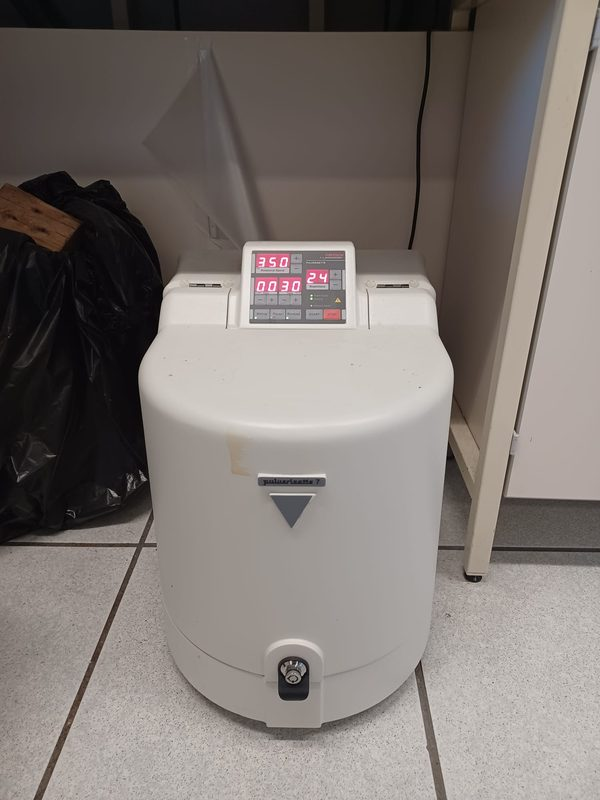
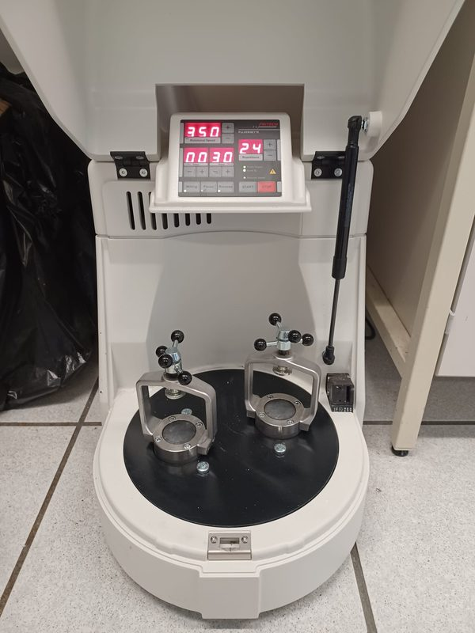
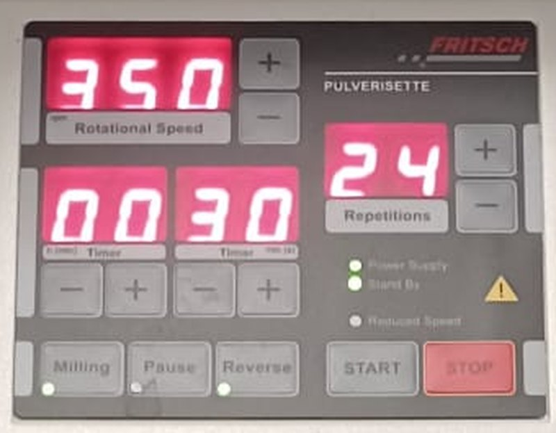

# Fritsch Pulverisette 7 classic line (planetary micro mill)

| | |
|---|---|
| **What it is for** | Mechanochemical synthesis and mixing, e.g. 75Li₂S–25P₂S₅ glass ([procedure](../procedures/lps-ball-milling.md)) |
| **Speed** | 100–800 rpm in steps of 10 |
| **Program** | Milling time, pause time (0–99 min 59 s each, or h:min in setup mode), repetitions 0–99, optional reverse mode |
| **Air-free milling** | In the lab, a ZrO₂ pot with polymer gasket is sealed **inside a stainless-steel tank** with PTFE spacers and a rubber gasket — loaded in the glovebox |
| **Training** | Required. Report any fault or damage to the lab manager immediately |
| **Manuals** | [Manuals and references](../manuals.md#ball-mill) |

!!! danger "Safety"
    - **Balance the mill.** Always clamp a bowl of the **same mass** (with lid and seal) in the opposite station. An empty counter-bowl is only acceptable if the difference is under 70–100 g. Unbalanced loads make the mill walk on the bench.
    - **Crushing hazard** at the spindle clamp. Keep fingers clear while tightening.
    - **Burn hazard.** Bowls get very hot during long runs (inside 20–30 °C hotter than the outer wall). Wear thermal gloves to remove them. Maximum outer-wall temperature: 100–110 °C (agate: 70–80 °C).
    - Never open a sealed sulfide pot outside the glovebox.

## Our set-up { #our-set-up }

<figure markdown>
{ loading=lazy }
<figcaption>Our Pulverisette 7 classic line with the hood closed. The control panel is on top of the hood; the hood lock is at the front.</figcaption>
</figure>

<figure markdown>
{ loading=lazy }
<figcaption>Hood open: the two bowl stations on the sun disc, each with a clamping bracket and star knob. A gas spring holds the hood up.</figcaption>
</figure>

<figure markdown>
{ loading=lazy }
<figcaption>Control panel: rotational speed (rpm), timer, repetitions, the Milling, Pause and Reverse keys, and START / STOP.</figcaption>
</figure>

## Demonstration

--8<-- "ball-mill.svg"

1. **In the glovebox, load the pot.** Put the powder and the milling balls into the ZrO₂ pot (for 75Li₂S–25P₂S₅: 1 g of hand-mixed powder with 90 g of Ø 5 mm balls).
2. **Close the pot** with the white polymer gasket and the ZrO₂ lid.
3. **Seal the steel tank.** Put the pot in the stainless-steel tank with a PTFE spacer below and above it, fit the rubber gasket and close the tank. Only now can it leave the glovebox.
4. **Switch the mill on** with the main switch at the back (the POWER SUPPLY lamp lights). The hood can only be opened when the mill is on: press the handle and lift it carefully.
5. **Load both stations.** Check that the cork discs are present and not flattened. Put the tank in one station and a bowl of the **same mass** in the opposite station.
6. **Clamp.** Turn the spindle screw (13) down until the pressure piece sits flat on the lid and tighten it **by hand**; then turn the lock nut (14) down flush onto the bracket and tighten it by hand. Do both stations.
7. **Set the speed** with the + / − keys (510 rpm for the 75Li₂S–25P₂S₅ procedure).
8. **Set the program.** Press **MILLING** and set the run time, press **PAUSE** and set the pause time (0 if none), then set the number of **REPETITIONS**. Use **REVERSE** if you want the direction to change after each run (needs at least 1 repetition).
9. **Close the hood and press START.** The hood locks and the mill runs. If it is overloaded, the REDUCED SPEED lamp flashes and the speed drops.
10. **Check the clamps.** After the first few minutes, press **STOP**, wait for the hood to unlock and check that both spindle screws and lock nuts are still tight. Press **START** to continue — the mill remembers the elapsed time and repetitions.
11. **Finish.** Press **STOP**; the hood unlocks shortly after the mill stops. Wear thermal gloves, remove the tank and take it into the glovebox before opening. Switch the mill off at the main switch.

!!! warning "Duty cycle"
    The Pulverisette 7 classic line is designed for **8-hour shifts at a 30 % duty cycle** (e.g. 3 min milling + 7 min pause) and **not for continuous operation** (Fritsch operating instructions, §2). A single long, uninterrupted run — such as **24 h at 510 rpm without pauses** in the current LPS procedure — exceeds this and increases wear and heating. If the 24 h run is kept, program milling/pause cycles and discuss the impact on the synthesis with your supervisor: pauses change the thermal history of the powder, so the result must be re-validated.

## Cleaning

- Grinding parts: follow the Fritsch *Usage, care and cleaning* leaflet for each material (ZrO₂, agate, steel). Never put hot bowls into cold water.
- Wipe the grinding chamber after use and report any powder that escaped from a bowl (a sign of a loose clamp or worn seal).
