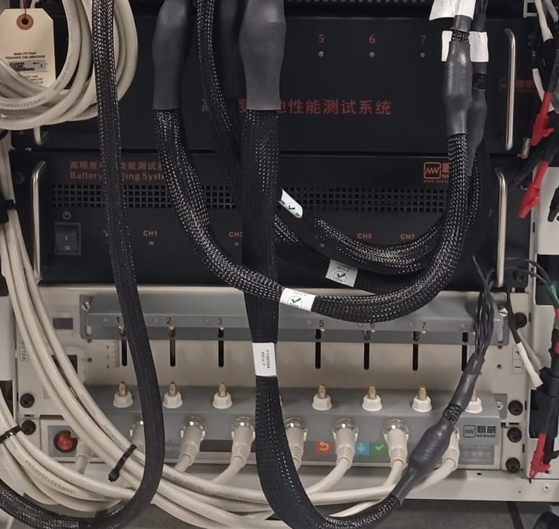
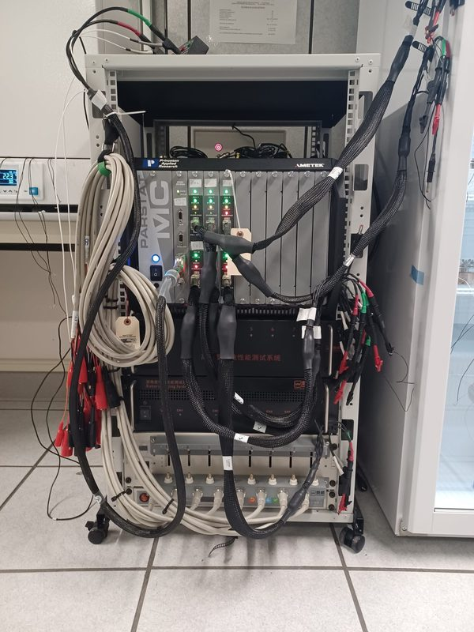

# Neware 电池充放电测试仪（CT-4008、CT-4008T、CT-5008、CT-9008）

## 哪种电池用哪台测试仪？

测试仪必须能够准确地<strong>施加并测量</strong>您的电流。精度以<strong>量程满量程</strong>的百分比表示，因此在大量程上使用小电流是不准确的。

| 设备 | 电压 | 电流量程 | 精度（电流） | 适用于 |
|---|---|---|---|---|
| <strong>CT-9008-5V6A-F</strong> | −5 至 +5 V | 0.1–180 µA · 180 µA–6 mA · 6–180 mA · 0.18–6 A | ±36 nA · ±1.2 µA · ±36 µA · ±1.2 mA | <strong>固态微型电池、低倍率扣式电池</strong> |
| CT-5008-5V12A-TF | −3 至 +5 V | 0.12–120 mA · 0.12–1.2 A · 1.2–12 A | ±0.02% FS（最低量程 ±24 µA） | ~1 mA 以上的扣式和软包电池 |
| CT-4008Q-5V12A-S1 | 25 mV–5 V（使用通用夹具时放电最低 2 V） | 0.2–100 mA · 0.1–0.5 A · 0.5–6 A · 6–12 A | ±0.02% FS | 较大的电池；<strong>不</strong>适用于放电至 2 V 以下的电池 |
| CT-4008T-5V12A-S1-F | −1 至 5 V | 5 mA–1 A · 1–6 A · 6–12 A | ±0.05% FS | 需要 ≥ 5 mA 的电池 |

<small>摘自实验室文件中的 Neware 规格书。FS = 满量程。</small>

### 选择电流 { #choosing-the-current }

1. 估算容量：<em>Q</em>（mAh）= 活性物质质量（g）× 预期比容量（mAh g⁻¹）。
2. <em>n</em> C 倍率对应的电流：<em>I</em> = <em>n</em> × <em>Q</em>（<em>Q</em> 以 mAh 计时，单位为 mA）。
3. 选择最低量程能以可接受误差<strong>覆盖</strong> <em>I</em> 的设备和量程（目标 < <em>I</em> 的 1%）。

<em>示例：</em>[固态测试电池](../cells/solid-state-battery.md)约为 0.57 mAh → 0.1 C ≈ 57 µA → <strong>CT-9008，量程 1</strong>（误差 ±36 nA ≈ 0.06%）。在 CT-4008/5008 上，同样的电流低于最低量程，精度（±20–24 µA）约为电流的 40%。

## 本实验室的装置 { #our-set-up }

<figure markdown>
{ loading=lazy }
<figcaption>电化学工作站下方的 Neware 测试仪。通道号印在每台设备的前面板上。各设备的电流量程不同（见上表），启动通道前请核对设备上的型号标签。</figcaption>
</figure>

<figure markdown>
{ loading=lazy }
<figcaption>仪器机柜：上方是 PARSTAT MC 电化学工作站，下方是 Neware 电池测试仪。电池线缆挂在机柜两侧。</figcaption>
</figure>

## 演示——BTS 软件

--8<-- "neware-bts.svg"

1. 在设备列表中<strong>选择设备</strong>（此处为用于微型电池的 CT-9008），找到一个空闲通道。请先在[预约页面](../booking.md)预约该通道。
2. 将<strong>电池连接</strong>到通道（四线开尔文夹：两个红夹接正极，两个黑夹接负极）。通道框会显示开路电压；等待其稳定。
3. <strong>右键单击通道 ▸ Single start。</strong>
4. <strong>编写或加载工步文件。</strong>典型流程：<em>Rest</em>（OCV）→ <em>恒流充电</em>（电流、上限截止电压）→ <em>Rest</em> → <em>恒流放电</em>（电流、下限截止电压）→ <em>Cycle</em> 回到第 2 步，<em>N</em> 次 → <em>End</em>。将<strong>保护限值</strong>（上、下限电压）设在截止电压之外一点。不同 BTS 版本的工步名称略有不同（例如 CC_Chg / CCC、CC_DChg / CCD）。
5. <strong>填写测试信息</strong>：唯一的名称/条码（姓名缩写、电池类型、日期、编号）、<strong>活性物质质量</strong>（以便容量以 mAh g⁻¹ 表示），以及工步文件。按 <strong>Start</strong>。
6. <strong>确认已启动</strong>：通道框变为 <em>working</em>，并显示工步、电压和电流。观察最初几分钟——符号错误或电压处于限值，说明接线或工步有误。
7. <strong>查看数据</strong>：右键 ▸ View data 打开 <strong>BTSDA</strong>，可绘制 V–t 和容量–循环曲线，并<strong>导出到 Excel</strong>。
8. <strong>结束</strong>：测试在 <em>End</em> 处结束，或右键 ▸ <strong>Single stop</strong>。断开电池并释放您的预约。

!!! warning "启动通道之前"
    - 切勿启动他人已预约或显示 <em>working</em> / <em>pause</em> 的通道。
    - 在 BTS 中输入的电压是<strong>相对于对电极</strong>的。使用 Li–In 负极时，将相对于 Li⁺/Li 的限值减去约 0.6 V。
    - 固态电池在整个测试过程中都需要堆叠压力——不要在工步之间松开电池。
