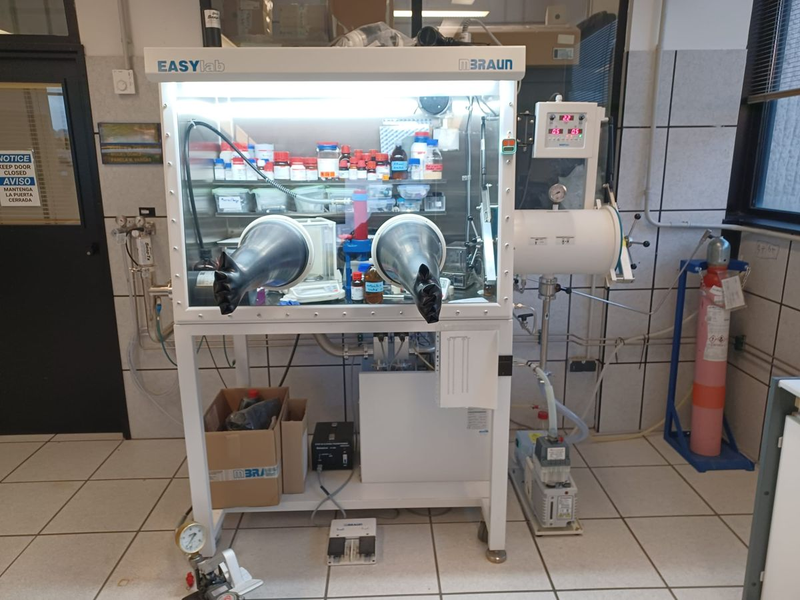
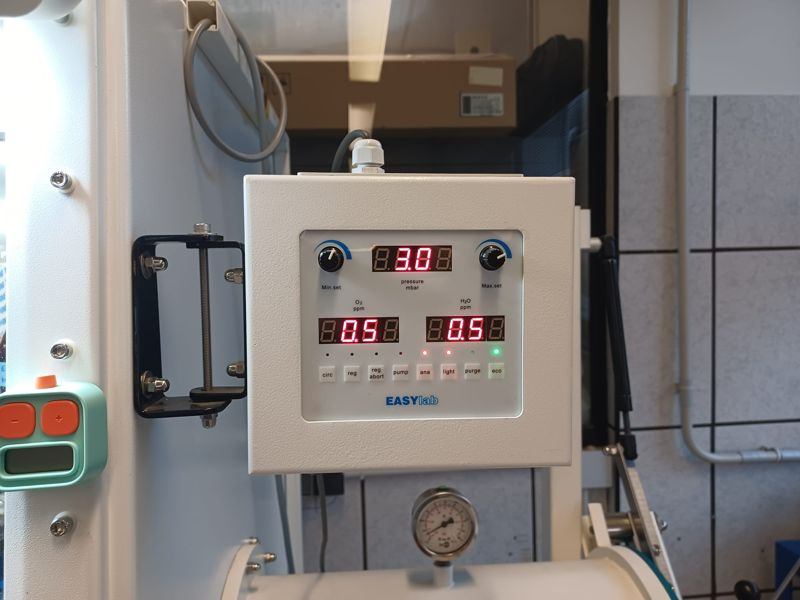
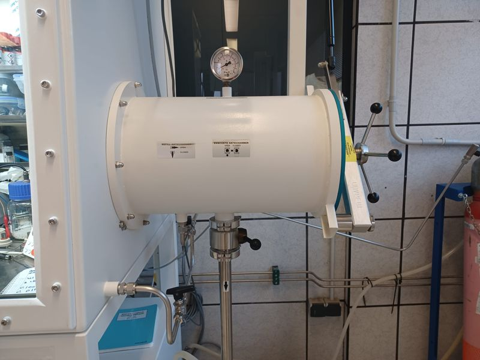
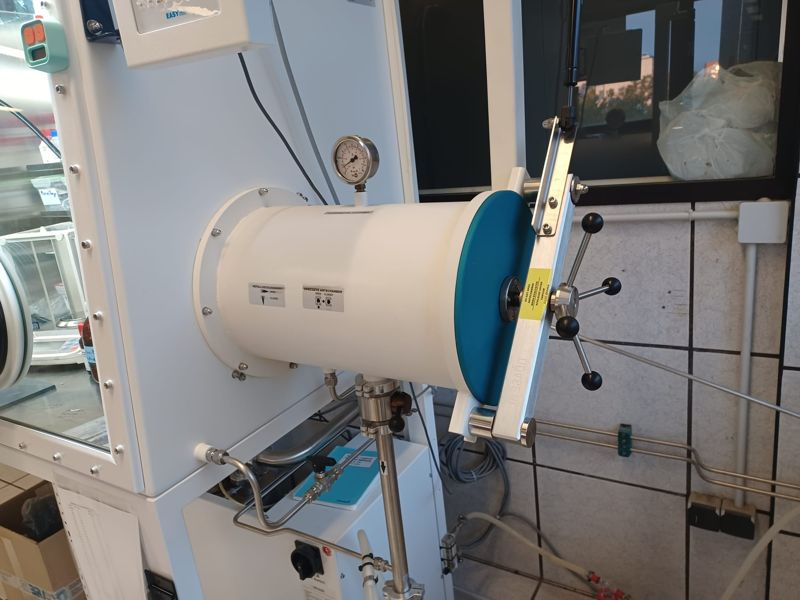
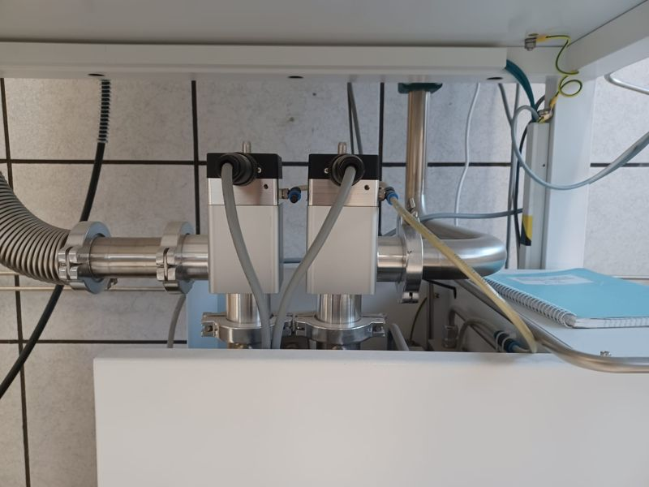
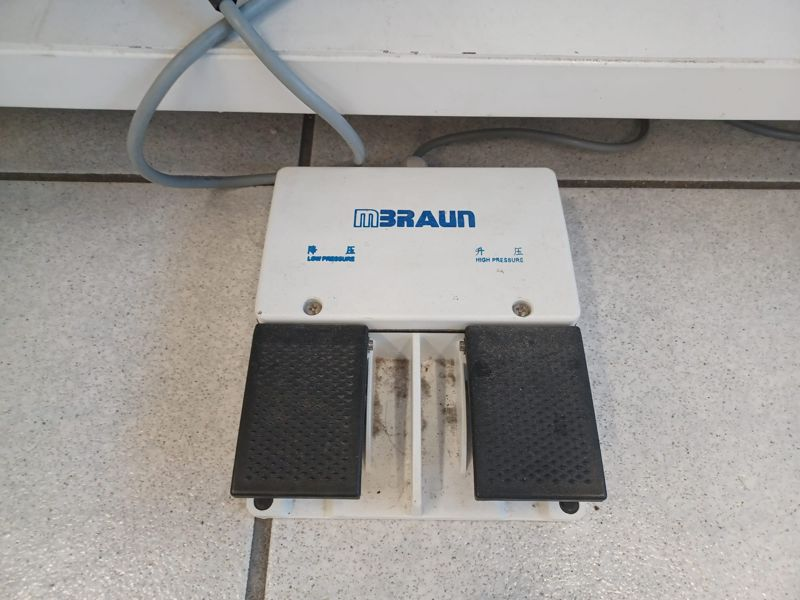
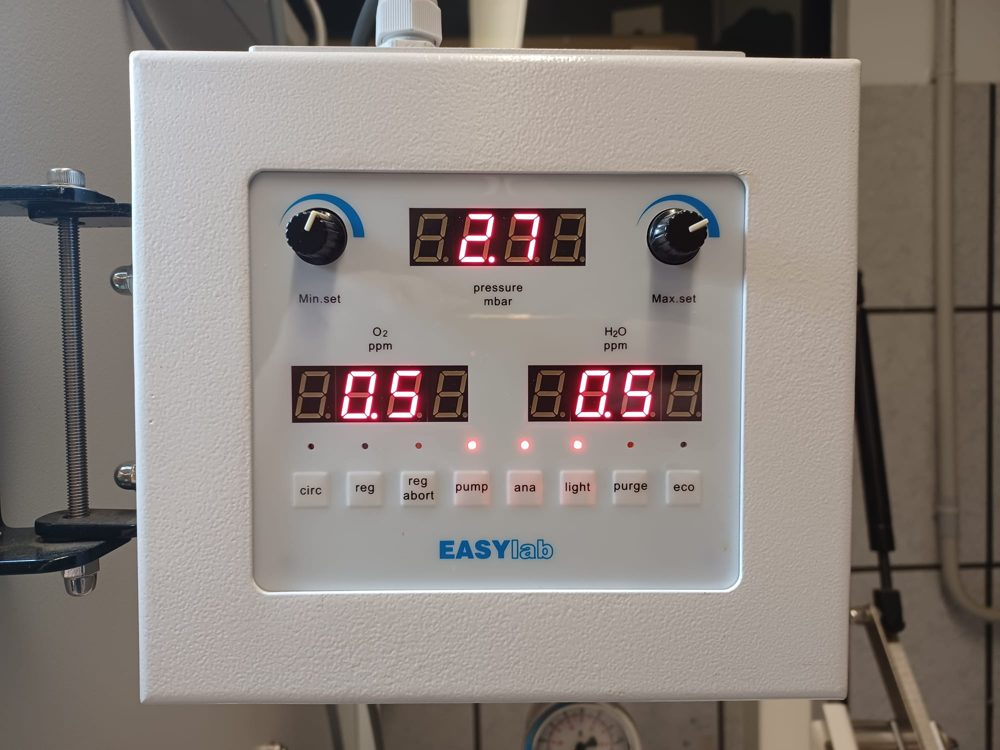

# MBraun EasyLab グローブボックス

| | |
|---|---|
| <strong>用途</strong> | 大気・水分に敏感な材料（硫化物電解質、金属 Li、Li₂S、P₂S₅）をアルゴン下で扱う |
| <strong>雰囲気</strong> | Cu 触媒とモレキュラーシーブで精製したアルゴン。O₂ センサーと H₂O センサーの測定範囲は 0–1000 ppm と 0–500 ppm |
| <strong>トレーニング</strong> | 必須。予約前にグローブボックスの試験に合格すること |
| <strong>予約</strong> | [装置の予約](../booking.md) |
| <strong>取扱説明書</strong> | [取扱説明書と参考資料](../manuals.md#glovebox) |

!!! danger "始める前に"
    - ボックス内で化学薬品を扱うときは、白衣、保護メガネ、そして<strong>ボックスのブチル手袋の上にニトリル手袋</strong>を着用してください。
    - 開放した溶媒容器を前室に入れて真空引きしないでください。密閉した溶媒瓶には半真空の手順（ステップ 9）が必要です。
    - O₂ または H₂O の値が高い場合は作業を止め、研究室責任者に連絡してください。敏感な材料を開けないでください。

## 当研究室のグローブボックス { #our-glovebox }

{ loading=lazy }

<figure markdown>
{ loading=lazy }
<figcaption>ECO モードのコントロールパネル。来たときと帰るときはこの状態です（eco の LED が緑）</figcaption>
</figure>

<figure markdown>
{ loading=lazy }
<figcaption>前室：上部に圧力計、バルブ表示 REFILL（アルゴン）と EVACUATE（真空）</figcaption>
</figure>

<figure markdown>
{ loading=lazy }
<figcaption>外扉：前室が真空のときは開けないでください</figcaption>
</figure>

<figure markdown>
{ loading=lazy }
<figcaption>ボックス下の電磁循環バルブ：ピストンは「上」でなければなりません</figcaption>
</figure>

<figure markdown>
{ loading=lazy }
<figcaption>フットペダル：左 = LOW PRESSURE（減圧）、右 = HIGH PRESSURE（加圧）</figcaption>
</figure>

## コントロールパネル { #control-panel }

{ loading=lazy width="480" }

| 部位 | 機能 |
|---|---|
| <strong>pressure mbar</strong>（上部表示） | 室内に対するボックスの圧力（mbar）。通常はわずかな陽圧で、ECO モードでは +2〜+6 mbar に保たれます。再生中もボックス圧力を表示します。 |
| <strong>O₂ ppm</strong> と <strong>H₂O ppm</strong> | アルゴン中の酸素と水分。再生中は代わりに工程と残り時間（分）を表示します。 |
| <strong>Min.set</strong> / <strong>Max.set</strong> ノブ | ボックス圧力制御の下限と上限。<strong>変更しないでください。</strong> |
| <strong>circ</strong> | 精製器を通るアルゴンの循環。再生時以外は<strong>常にオン</strong>でなければなりません。<strong>既知の不具合：</strong>当研究室のボックスの circ LED はごく暗くしか光らないため、循環中でも消えて見えることがあります。代わりに循環ピストンを確認してください：<strong>上 = 循環オン</strong>。下がっていればラボ管理者に連絡してください。 |
| <strong>reg</strong> / <strong>reg abort</strong> | 触媒再生の開始 / 中止（reg abort は最初の工程でのみ有効）。ラボ管理者のみ。 |
| <strong>pump</strong> | 真空ポンプ。前室を排気するにはオンにする必要があります。 |
| <strong>ana</strong> | O₂・H₂O 分析計。オンのままにします。 |
| <strong>light</strong> | ボックス内照明。 |
| <strong>purge</strong> | アルゴンでボックスをパージして O₂/H₂O を下げます。ラボ管理者の指示があるときのみ。 |
| <strong>eco</strong> | 待機：ボックスがアルゴンを必要とするときだけポンプが動き、照明は消え、圧力は +2〜+6 mbar。使用後は ECO にしておきます。 |

!!! warning "既知の不具合：暗い circ LED"
    当研究室のグローブボックスの <strong>circ</strong> LED は故障しています。循環がオンのときは点灯していますが、暗すぎて消えているように見えます。この LED で循環を判断しないでください。確認するのはボックス下の循環バルブのピストンです（<strong>上 = オン</strong>）。

!!! tip "通常の作業状態"
    圧力は数 mbar（ここでは 2.7）、O₂ と H₂O は 1 ppm 未満（ここでは 0.5）、<strong>pump</strong>・<strong>ana</strong>・<strong>light</strong> の LED が点灯。写真で <strong>circ</strong> の LED が消えて見えるのは、故障していてごく暗いためです。代わりに循環ピストンを確認してください。

## デモンストレーション { #demonstration }

--8<-- "glovebox.svg"

1. <strong>最初の状態を確認します。</strong>ボックスは <strong>ECO</strong> モードで、前室の扉は両方閉まり、前室は完全真空（圧力計 ≈ −94 kPa）、すべてのバルブが閉じているはずです。センサー画面で O₂ と H₂O の値を読みます。
2. <strong>ボックスを起動します。</strong><strong>ECO</strong> を 1 回押して ECO モードを解除し、<strong>PUMP</strong> を 1 回押します。<strong>LIGHT</strong> はいつでも点灯・消灯できます。
3. <strong>循環を確認します。</strong>アルゴンは常に触媒を通って循環していなければなりません（再生中を除く）。このボックスの <strong>CIRC</strong> LED は故障していてごく暗くしか光らないので頼らないでください。ボックスの下、精製器の上にある電磁循環バルブのピストンを見ます（上の写真参照）。<strong>上</strong>にあるはずです。下がっている場合は、敏感な試料を開ける前にラボ管理者に連絡してください。
4. <strong>前室をアルゴンで満たします。</strong>前室とメインチャンバーをつなぐ<strong>アルゴン（充填）バルブ</strong>をゆっくり開けます。圧力計が −94 kPa から 0 kPa に上がるのを確認し、バルブを閉じます。
5. <strong>物品を入れます。</strong><strong>外扉</strong>を開け、物品を前室に置き、外扉を閉じます。液体の容器は閉じたままにします。粉末や固体は開けたまま、またはふたを緩めた状態で構いません。
6. <strong>真空引き（サイクル 1）。</strong>両方の扉とアルゴンバルブが閉じていることを確認します。圧力計が −94 kPa を示すまで<strong>真空バルブ</strong>をゆっくり開け、真空を <strong>15 分</strong>保持してからバルブを閉じます。
7. <strong>アルゴンで充填します。</strong>圧力計が 0 kPa に戻るまでアルゴンバルブをゆっくり開け、閉じます。
8. 真空–保持–充填を合計 <strong>3 サイクル</strong>になるまで<strong>繰り返します</strong>。多孔質やかさばる物品（繊維、紙、フォーム）は、一晩真空に置いてから完全なサイクルを 1 回行うのが最適です。
9. <strong>特別な場合——密閉した溶媒瓶。</strong>密閉瓶は完全真空で破裂するおそれがあります。<strong>半真空</strong>（≈ −47 kPa）までだけ引き、数分待ってから充填し、これを<strong>少なくとも 10 回</strong>繰り返します。
10. <strong>物品を中に入れます。</strong>最後の充填後（圧力計 0 kPa、両バルブ閉）、グローブに手を入れ、<strong>内扉</strong>を開け、物品をメインチャンバーに移して内扉を閉じます。
11. <strong>快適に作業します。</strong>ボックスは自動で圧力を調整します。グローブがきつすぎる・ゆるすぎる場合は、<strong>フットペダル</strong>でチャンバー圧を上げる（+）か下げます（−）。左のペダル = <strong>LOW PRESSURE</strong>、右のペダル = <strong>HIGH PRESSURE</strong>。
12. <strong>作業を終了します。</strong>こぼれたものを片付け、グローブは<strong>エタノールのみ</strong>で拭き、内扉と外扉を閉じ、真空バルブを開けたまま前室を<strong>少なくとも 5 分</strong>真空引きします。
13. <strong>元の状態に戻します。</strong>真空バルブを閉じ（圧力計は ≈ −94 kPa のまま）、すべてのバルブが閉じていることを確認し、<strong>ECO</strong> を 1 回押し、循環ピストンが<strong>上</strong>にあることを確認します。

## 物品の取り出し { #taking-material-out }

1. 前室が真空なら、ゆっくりアルゴンで 0 kPa まで充填し、アルゴンバルブを閉じます。
2. 内扉を開け、物品を置いて内扉を閉じます。
3. 外扉を開け、物品を取り出して外扉を閉じます。
4. 前室を真空引きし、アルゴンで 1 回パージし、再度真空引きして、すべてのバルブを閉じた状態で真空のままにします。

## ボックスを傷めるもの { #things-that-damage-the-box }

!!! warning "触媒毒"
    銅触媒は<strong>硫黄化合物と酸によって不可逆的に被毒</strong>し、活性炭フィルターが飽和するとモレキュラーシーブも H₂S や溶媒蒸気を吸着します（研究室ガイド <em>Guía MBraun EasyLab</em>、rev. 07-2022）。硫化物電解質（Li₂S、P₂S₅、Li₆PS₅Cl、Li₃PS₄）は微量の水分で H₂S を発生します。使わないときは硫化物の容器を閉じ、硫化物粉末を一晩開けたままにせず、ボックス内で使った薬品を記録して、O₂ 除去能力の低下を追跡できるようにしてください。

!!! note "溶媒"
    揮発性溶媒（エタノール、アセトニトリル、THF など）は活性炭フィルターに負荷をかけ、センサーのドリフトを起こすことがあります。できるだけ少量を使い、瓶は閉じておきます。開放した溶媒を扱う間に循環を止めるべきかどうか研究室責任者に確認してください——現行の研究室手順には記載がありません。

## 再生とセンサー（研究室責任者のみ）

触媒/シーブの再生（16 段階、約 960 分、Ar/H₂ フォーミングガス ~15 L/min）と H₂O センサーの保守（~2000 時間ごとに 85% H₃PO₄ で再コーティング）は、研究室ガイドに従い研究室責任者のみが行います。

!!! question "研究室責任者に確認"
    2 つの研究室資料で前室サイクルの記載が異なります。英語の起動スライドは <em>「圧力を戻す前に少なくとも 5 分間完全真空」</em>、スペイン語の研究室ガイドは <strong>15 分保持の真空サイクルを 3 回</strong>（「アクティブ」モードでは 45 分）としています。本ガイドはより厳しい 3 × 15 分を採用しています。研究室の規則を確認してください。

## 取扱説明書

- 研究室ガイド：<em>Guía MBraun EasyLab</em>（スペイン語、rev. 07-2022）——研究室のコピー。
- 研究室スライド：<em>MBraun EasyLab Glovebox — Operation start guide</em>——研究室のコピー。
- メーカー：[MBraun EASYlab 製品ページ](https://shop.mbraun.de/ENU/28934/EASYlab.html)。
