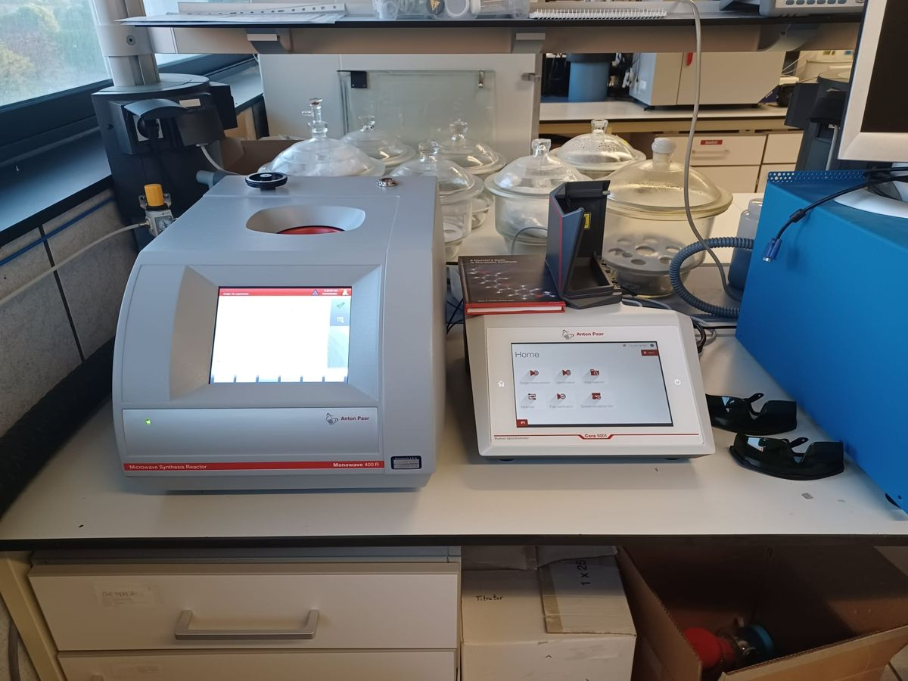

# Anton Paar Monowave 400 R

| | |
|---|---|
| **What it is for** | Liquid-phase synthesis in sealed vials with magnetic stirring under temperature and pressure control, e.g. solution routes to sulfide electrolytes |
| **Limits** | Up to **300 °C** and **30 bar**; single 850 W magnetron; stirring up to 1200 rpm |
| **Special feature** | The "R" version holds a fibre-optic **Raman probe of the Cora 5001** for in-situ spectra during the reaction (laser class 3B) |
| **Needs** | Compressed air at **5.5–6 bar** for correct pressure measurement and vial sealing |
| **Training** | Required. Laser safety briefing required for Raman runs |
| **Manuals** | [Manuals and references](../manuals.md#monowave) |

### Reaction vials

| Vial | Volume | Fill volume | Max T | Max p | Max time |
|---|---|---|---|---|---|
| G4 (glass) | 4 mL | 0.5–2 mL | 250 °C | 30 bar | 100 h |
| **G10** (glass) | 10 mL | **2–6 mL** | 300 °C | 30 bar | 100 h |
| **G30** (glass) | 30 mL | **6–20 mL** | 300 °C | 30 bar | 100 h |
| G30 Wide Neck | 30 mL | 6–20 mL | 200 °C | 15 bar | 4 h |
| C10 (SiC) | 10 mL | 2–6 mL | 300 °C | 30 bar | 100 h |
| C30 Wide Neck (SiC) | 30 mL | 6–20 mL | 200 °C | 15 bar | 4 h |

<small>From the Monowave 400 R Reference Guide (E07IB012EN-C), Table 1. For Raman experiments the shorter time limits of its Appendix C apply. G4 and SiC vessels **cannot** be used with the Raman probe.</small>

!!! danger "Before you start"
    - **Laser class 3B.** Disarm the Raman probe (Stop button on the probe) before moving the slide or the probe, and never look into the probe or the fibre.
    - Always select the **vial type that you are actually using**. A wrong vial type gives wrong temperature/pressure readings and can rupture the vial.
    - Respect the minimum fill volume: the IR sensor reads the vial wall ~1 cm above the bottom.
    - If you do not know how your reaction behaves, start with small amounts and the highest dilution.
    - The instrument is **not acid resistant**; corrosive reagents shorten its life (Quick Start sheet).
    - Air-sensitive reactions: fill and cap the vial **in the glovebox**. If a vial vents, the exhaust carries reaction vapours (for sulfide chemistry, possibly H₂S) — the exhaust must go to extraction.

## Our set-up

<figure markdown>
{ loading=lazy }
<figcaption>Our Monowave 400 R (left) and Cora 5001 (right). The compressed-air regulator is on the left; laser safety glasses are kept next to the Cora.</figcaption>
</figure>

## Demonstration

--8<-- "monowave.svg"

1. **Check the compressed air.** The supply must be at 5.5–6 bar before you start.
2. **Fill the vial.** Put a suitable stir bar in a G10 (2–6 mL) or G30 (6–20 mL) vial and add the reaction mixture.
3. **Seal the vial.** Put the septum in the snap cap with its **PTFE face towards the reaction mixture** and press the cap on until it does not open when you press its edge. Silicone septum: runs under 4 h. PTFE disk + PTFE septum: runs over 4 h (the PTFE septum is single-use).
4. **Program the experiment.** On the touchscreen tap **Task List**, tap the last row, name the experiment, choose **Standard** and set the steps (heat, hold, cool). The cooling temperature (30–70 °C) must be about 10 °C below the boiling point of your solvent. **Select the vial type you are using** and tap OK.
5. **Set the Raman probe.** With the laser **disarmed**, move the slide to the **G10** (innermost) or **G30** (middle) position, or to **idle** (outermost) if you are not recording Raman. Check that an empty, open vial of your size slides into the cavity without resistance.
6. **Insert the vial.** G4, G10 and C10 vials need the **adaptor ring** (polyimide side up) on the cavity insert; G30 vials go in directly.
7. **Start.** Tap **Start**. With the blind pin installed (no Ruby thermometer) the run starts and the swivelling cover closes.
8. **Start the Raman measurement** on the Cora 5001 only **after the cover has closed** (see the [Cora 5001 guide](cora.md)).
9. **Monitor** temperature, pressure, power and stirring on the main screen. You can edit a running experiment by tapping its widgets.
10. **Stop.** At the end — or to stop early — **stop the Raman measurement and disarm the laser first**, then (to stop early) tap **Stop → Yes**. The instrument cools the vial and opens the cover when it is safe.
11. **Remove and open the vial.** Take the vial out carefully. Open it with the capping tool like a bottle opener (careful if an immersion tube is fitted).
12. **Export the data.** Menu ▸ Data Memory ▸ Browse Results ▸ select ▸ Export to USB (.pdf, .csv, .xls, .raw, .png). The instrument keeps up to 1000 results.

## Good to know

- **Temperature sensors.** The built-in IR sensor (±5 °C) measures the vial wall. The optional Ruby fibre-optic thermometer (±2 °C) measures inside the mixture and is better for exothermic reactions or poorly absorbing solvents — but it **cannot be used together with the Raman probe** and not for runs longer than 4 h.
- **Low-absorbing solvents** (e.g. toluene, hexane) heat poorly; the instrument may reduce power and never reach the set temperature. Well-absorbing solvents in G4 vials can overshoot: limit the power or use "Heat to temperature in time".
- **Without Raman:** put the probe in idle and fit the unmodified cavity insert, so a vial rupture cannot damage the probe.

## Related

- In-situ Raman during liquid-phase sulfide electrolyte synthesis: see [References](../references.md#group-publications).
