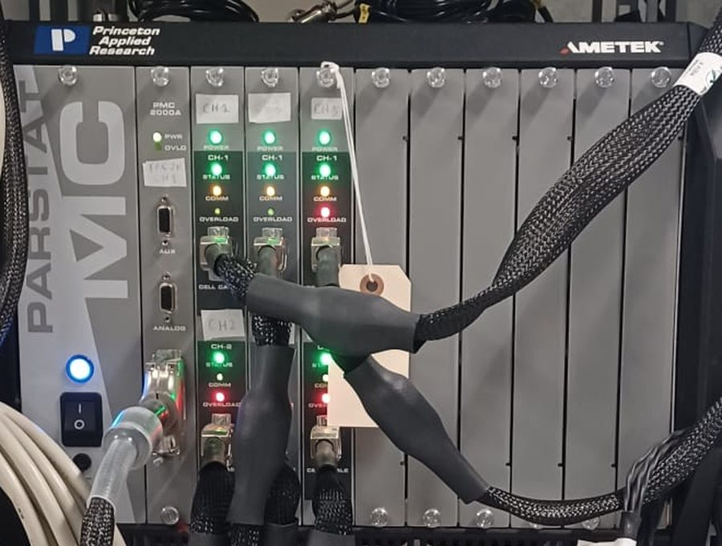

# PARSTAT MC · PMC-2000과 VersaStudio

| | |
|---|---|
| <strong>용도</strong> | EIS, DC 분극(전자 전도도), CV, 소전류 전지 사이클 |
| <strong>PMC-2000 채널</strong> | ±30 V 컴플라이언스, ±1 A, EIS <strong>10 µHz – 7 MHz</strong>, 최소 전류 범위 4 nA, 차동 전위계 ≥ 10 MHz |
| <strong>소프트웨어</strong> | VersaStudio(Windows) — 데이터 파일 `.par`(바이너리 저장을 켜면 `.par.psbd` 추가) |
| <strong>셀</strong> | [AC 임피던스 셀](../cells/eis-cell.md) — 하드웨어 부분은 해당 시연 참조 |
| <strong>설명서</strong> | [설명서와 참고 자료](../manuals.md#potentiostat) |

## 우리 실험실 장비 { #our-set-up }

<figure markdown>
{ loading=lazy }
<figcaption>PARSTAT MC 섀시. 각 채널은 테이프로 표시되어 있고, 채널마다 POWER, STATUS, COMM, OVERLOAD LED와 셀 케이블 커넥터가 있습니다. 주 전원 스위치는 왼쪽 아래에 있습니다.</figcaption>
</figure>

<figure markdown>
{ loading=lazy }
<figcaption>장비 랙: 위쪽이 PARSTAT MC 포텐쇼스탯, 아래쪽이 Neware 배터리 사이클러입니다. 셀 케이블은 랙 양쪽에 걸려 있습니다.</figcaption>
</figure>

## 셀 케이블 색상(PMC-2000 케이블)

| 색 | 리드 | 2전극 셀(EIS 셀, 전지) |
|---|---|---|
| 초록 | WE — 작업 전극 | 회색과 함께 <strong>한쪽</strong> 전극에 |
| 회색 | SE — 센스 | 초록과 함께 |
| 빨강 | CE — 상대 전극 | 흰색과 함께 <strong>다른 쪽</strong> 전극에 |
| 흰색 | RE — 기준 전극 | 빨강과 함께 |
| 노랑 / 파랑 | E2+ / E2−(6번째 선) | 사용 안 함 |
| 검정 | GND | 사용 안 함 — 다른 리드에 닿지 않게 |

<strong>저임피던스 셀이나 100 mA를 넘는 전류</strong>에서는 접촉 저항에 의한 전압 오차를 피하기 위해 리드를 겹쳐 꽂지(“피기백”) 말고 단자에 하나씩 따로 연결하십시오(PMC-2000 설명서, §3).

## 시연 — 소프트웨어

--8<-- "versastudio.svg"

1. <strong>시작.</strong> 보정 전에 PARSTAT MC를 최소 10분 켜 두어야 합니다. <strong>VersaStudio</strong>를 엽니다(시작 ▸ VersaStudio). 채널이 여러 개이면 <strong>No Instrument</strong>가 선택된 상태로 열립니다.
2. <strong>자신의 채널을 선택합니다.</strong> Tools ▸ <strong>Select Instrument</strong>에서 채널을 더블클릭합니다. 오른쪽 클릭 ▸ <em>Locate Instrument</em>로 채널 LED를 깜빡이게 해 자신의 셀에 연결된 채널인지 확인할 수 있습니다. <strong>DATA</strong>로 표시된 채널은 다른 사람이 사용 중입니다 — 선택하지 마십시오.
3. <strong>검증(의심스러울 때).</strong> Experiment ▸ Load Setup ▸ <em>Impedance Checkout</em>으로 <strong>내장 1 kΩ 더미 셀</strong>을 측정합니다. 모든 점이 1000 Ω ± 20 Ω이어야 합니다.
4. <strong>새 실험.</strong> Experiment ▸ <strong>New</strong> ▸ <em>Select an Action</em> ▸ Impedance ▸ <strong>Potentiostatic EIS</strong> ▸ OK를 누르고 데이터 파일 이름을 정합니다.
5. <em>Experiment Properties</em>에 <strong>파라미터를 입력합니다</strong>(EIS 셀 값은 [EIS 셀 페이지](../cells/eis-cell.md#measurement-settings-versastudio-potentiostatic-eis)). 값마다 <strong>Enter</strong>를 누르십시오 — 입력만 하고 확정하지 않은 값은 저장되지 않습니다. 시료 이름, 펠릿 두께와 면적을 <em>Common</em>에 주석으로 추가합니다.
6. <strong>고급 속성.</strong> <em>Cell to Use</em> = <strong>External</strong>, 전류 범위, 전위계 모드(2전극 셀은 single-ended, 4전극 셀은 차동), <em>Leave Cell On</em> = No.
7. <strong>필터.</strong> Tools ▸ Options ▸ Instrument: EIS에서는 <strong>Notch filter = None</strong>(필수). 바꿀 이유가 없으면 <em>EIS filters</em>는 Normal로 둡니다.
8. <strong>실행 전에 저장합니다.</strong> Experiment ▸ Save. 실험 중에 데이터가 디스크에 기록됩니다.
9. <strong>실행</strong>(▶). 나이퀴스트 선도가 그려집니다. <strong>■</strong>는 정지, <strong>⏭</strong>는 다음 구간으로 이동합니다.
10. <strong>보정된 데이터를 내보냅니다.</strong> EIS 액션은 Data ▸ Export To ▸ <strong>ZView (.z)</strong>, 또는 Graph View ▸ <em>Copy Data as Text</em>. <strong>`.par` 파일의 원시 EIS 열을 분석하지 마십시오</strong> — VersaStudio는 이를 보정되지 않은 상태로 저장합니다(소프트웨어 설명서, 부록 3).
11. <strong>채널을 해제합니다.</strong> 실험을 닫고 <em>No Instrument</em>로 돌아가 다음 사용자가 채널을 선택할 수 있게 합니다. 케이블은 정리해 둡니다.

## 전지의 DC 실험

- 전지와 기타 에너지 저장 셀은 전류 범위를 <strong>먼저 2 A</strong>로 설정하십시오(또는 2 A에서 시작하는 <em>Auto Current Range Setup</em> 액션 사용). 민감한 범위에서 "Auto"로 시작하면 과부하로 손상될 수 있습니다(소프트웨어 설명서, Current Range 주의).
- 정전위와 정전류 액션 사이, EIS와 DC 액션 사이, 서로 다른 전류 범위의 정전류 액션 사이에서 <strong>Leave Cell On</strong>은 위험합니다. 전환 시 셀에 전류 스파이크가 들어갈 수 있습니다.
- <em>Common</em>에서 전압과 전류 <strong>안전 한계</strong>를 설정하십시오 — 넘으면 전체 시퀀스가 멈춥니다.

## 소프트웨어 설정 메모(실험실 PC)

- Windows 전원 관리: 절전 안 함, 전원 버튼은 아무 동작 안 함, 빠른 시작 끄기 — 그렇지 않으면 장시간 실험에서 데이터가 손실될 수 있습니다(소프트웨어 설명서, §3.3).
- 소프트웨어 업데이트 후 VersaStudio가 펌웨어 업데이트를 요청할 수 있습니다. 중단 없이 끝나게 둔 뒤 각 채널에서 <em>Calibrate for best DC accuracy</em>를 실행하십시오.
