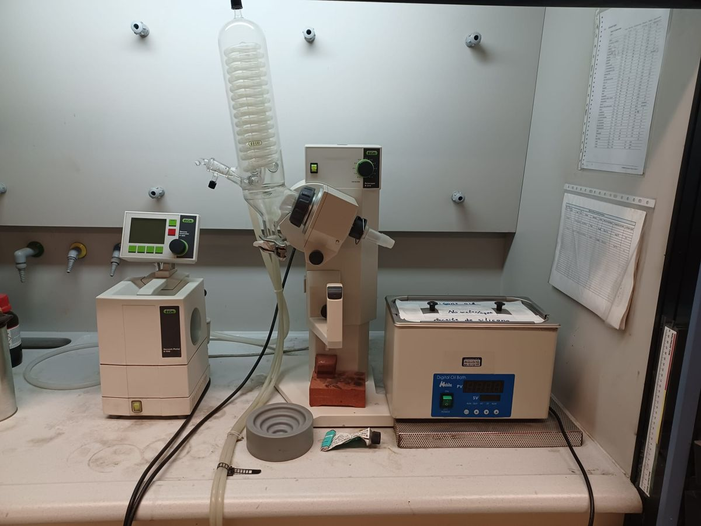
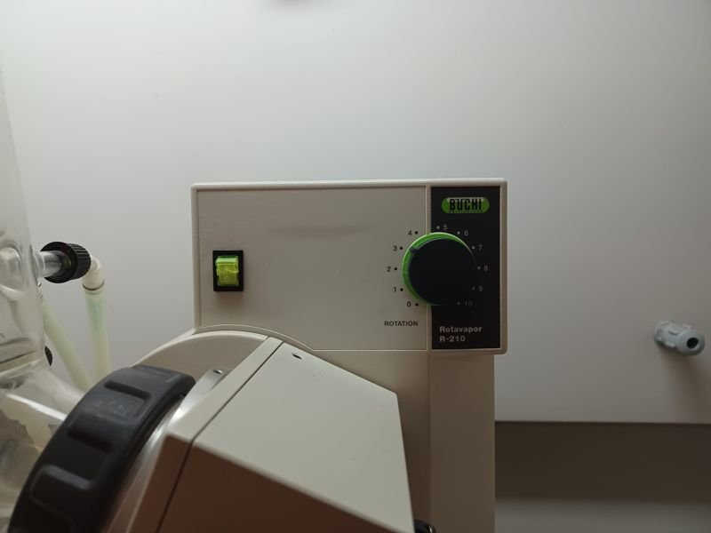
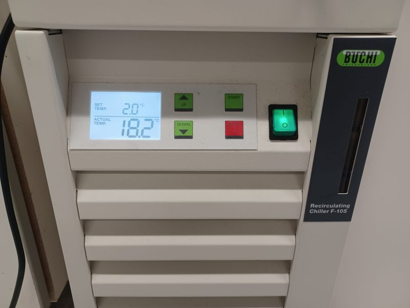
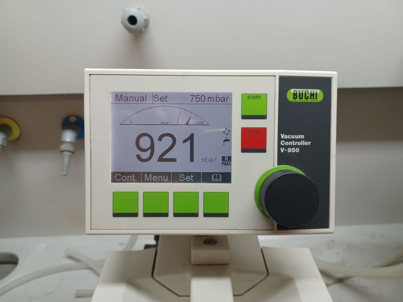
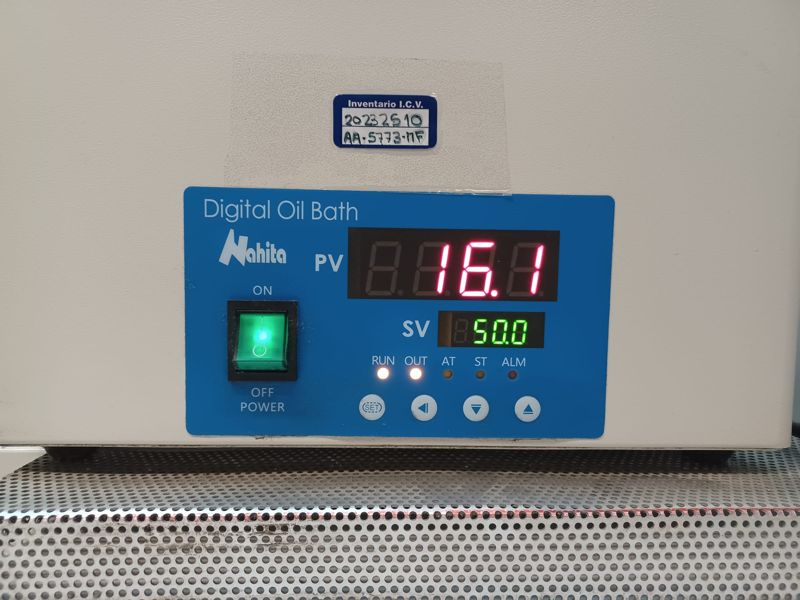

# Büchi Rotavapor R-210

| | |
|---|---|
| **Para qué sirve** | Eliminar disolvente a presión reducida, p. ej. secar la suspensión del composite catódico (etanol + acetonitrilo) |
| **Componentes** | **Recirculador Büchi F-105** (refrigerante del condensador) · **baño digital de aceite Nahita** lleno de **aceite de silicona** · **R-210** con interruptor, mando **ROTATION** (0–10), mando de inclinación, Combi Clip y elevador motorizado · condensador vertical y matraz colector · **controlador de vacío Büchi V-850** sobre la **bomba de vacío V-700** |
| **Matraz** | Para trabajo sensible al aire: un matraz de fondo redondo cerrado con un **adaptador con válvula (llave de vidrio)** y una **pinza Keck**, montado y cerrado en la caja de guantes (Parte 1) |
| **Formación** | Obligatoria. Apruebe el examen del rotavapor antes de reservar |
| **Manuales** | [Manuales y referencias](../manuals.md#rotavapor) |

!!! danger "Seguridad"
    - Bata, gafas de seguridad, guantes y calzado cerrado.
    - El baño de aceite de silicona puede alcanzar **180 °C**. Nunca añada agua ni ningún producto químico al baño: el agua en aceite caliente provoca salpicaduras violentas (manual Büchi, §2).
    - El aceite de silicona se dilata mucho al calentarse. Un baño que en frío parece medio lleno **no** está bajo — no lo rellene.
    - Revise todas las piezas de vidrio en busca de grietas o estrellas antes de usarlas: el vidrio dañado puede **implosionar** bajo vacío. Use las pinzas en todas las juntas.

## Nuestro equipo { #our-set-up }

{ loading=lazy }

<figure markdown>
{ loading=lazy }
<figcaption>R-210: interruptor y mando ROTATION</figcaption>
</figure>

<figure markdown>
{ loading=lazy }
<figcaption>Enfriador F-105</figcaption>
</figure>

<figure markdown>
{ loading=lazy }
<figcaption>Controlador de vacío V-850 (Manual)</figcaption>
</figure>

<figure markdown>
{ loading=lazy }
<figcaption>Baño digital de aceite Nahita: PV = real, SV = consigna</figcaption>
</figure>

## Parte 1 — Montar el matraz en la caja de guantes { #part-1-assemble-the-flask-in-the-glovebox }

La muestra nunca ve el aire: el matraz se llena, se cierra con el adaptador con válvula y se asegura con la pinza **dentro de la caja de guantes**, y solo se vuelve a abrir bajo vacío en el rotavapor.

--8<-- "rv-glassware.svg"

1. **Reúna las piezas en la caja de guantes:** el matraz de fondo redondo con su suspensión (sobre un aro de corcho), el **adaptador con válvula** y su llave de vidrio, **grasa de vacío** y una **pinza Keck** del tamaño de la junta.
2. **Revise el vidrio.** Las juntas deben estar limpias y sin desconchones; el matraz no debe tener grietas ni estrellas — estará bajo vacío.
3. **Engrase la junta.** Ponga una **banda fina** de grasa de vacío solo en la parte superior de la junta inferior (macho) del adaptador. Demasiada grasa penetra en el matraz y contamina la muestra.
4. **Inserte y gire.** Introduzca el adaptador en el cuello del matraz y gírelo suavemente hasta que la banda de grasa se vea transparente y continua, sin estrías ni canales de aire.
5. **Asegure la junta.** Coloque la **pinza Keck** sobre la junta para que el adaptador no pueda salirse.
6. **Cierre la válvula.** Gire la llave a **horizontal = cerrada** (vertical = abierta).
7. **Comprobación final:** pinza puesta, válvula en horizontal, matraz etiquetado. Mantenga limpia la junta superior (la que va al rotavapor).
8. **Sáquelo** por la antecámara ([guía de la caja de guantes](glovebox.md#taking-material-out)) y llévelo al rotavapor sujetando el matraz por el cuerpo. **Mantenga la válvula cerrada** hasta el paso 9 de la Parte 2.

!!! question "Comprobar con las diapositivas del laboratorio"
    Las diapositivas *Rotovapor* muestran la válvula del matraz (vertical = abierta, horizontal = cerrada), la grasa de vacío, la pinza Keck y la junta, y terminan con «cerrada → a rotovapor». Solo se pudo leer el texto de las diapositivas, no las fotos, así que el dibujo supone **un matraz de fondo redondo más un adaptador con llave separado**. Si el laboratorio usa un matraz con válvula integrada, los pasos 3–5 se aplican a la junta que se cierre en la caja de guantes — confírmelo.

## Parte 2 — En el rotavapor { #part-2-on-the-rotavapor }

--8<-- "rotavapor.svg"

1. **Comprobación de seguridad.** Póngase el EPI, mire el nivel de aceite y revise el vidrio. El baño debe contener solo aceite de silicona.
2. **Encienda el enfriador — solo la alimentación.** Pulse el interruptor verde del F-105: la pantalla se ilumina con SET TEMP y ACTUAL TEMP. **No** pulse START todavía.
3. **Ajuste el baño de aceite.** Encienda el baño Nahita (POWER). Pulse **SET**, cambie el valor de consigna (**SV**, verde) con ◄ ▼ ▲ y pulse **SET** otra vez. **PV** (rojo) es la temperatura real del aceite.
4. **Ajuste la presión** en el controlador de vacío V-850 (modo Manual): pulse la tecla **Set**, gire el mando negro hasta la presión que indique su procedimiento y confirme. La consigna aparece arriba en la pantalla ("Set … mbar"); el número grande es la presión real.
5. **Coloque el matraz colector.** Ponga una película fina de grasa de vacío en su junta y fíjelo bajo el condensador con su pinza de rótula.
6. **Coloque el matraz de la Parte 1.** Compruebe que la llave sigue **horizontal (cerrada)**. Pulse el botón de bloqueo del accionamiento, encaje la junta superior del adaptador en el conducto de vapor (requiere muy poca fuerza) y fíjelo con el **Combi Clip**: presione la abrazadera hacia abajo y gírela en sentido **horario**. Sujete el matraz con una mano hasta que quede fijado.
7. **Inicie el vacío.** Compruebe que la bomba de vacío V-700 está encendida (interruptor en su frontal), compruebe la consigna y pulse **START** en el controlador. El matraz cerrado aún no está expuesto al vacío.
8. **Inicie la refrigeración del enfriador** tras unos 5 min de vacío: pulse **START** en el F-105. Aparece un copo de nieve en su pantalla y ACTUAL TEMP baja hacia SET TEMP.
9. **Abra el matraz y empiece a girar.** Cuando el enfriador lleve al menos 5 min enfriando, gire la llave **despacio** hacia abierto (asa alineada con el adaptador): la presión sube brevemente. Encienda el rotavapor (interruptor verde en su panel superior) y gire el mando **ROTATION** hasta la velocidad que necesite.
10. **Ajuste la posición.** La perilla negra del accionamiento ajusta la inclinación del matraz; el asa con interruptor eléctrico sube y baja todo el conjunto de vidrio. El tope de seguridad en la parte inferior del elevador impide que el matraz baje demasiado.
11. **Baje el matraz lentamente** al baño de aceite.
12. **Evapore.** El disolvente condensa en el condensador y se recoge en el matraz colector. Vigile el burbujeo brusco; si ocurre, saque el matraz del baño y suba la presión fijada.
13. **Termine sin dejar entrar aire.** Con el vacío todavía activo y la llave abierta, detenga la rotación (mando **ROTATION** a 0), saque el matraz del baño y deje que se enfríe bajo vacío. Solo entonces **cierre la llave** (asa atravesada respecto al adaptador).
14. **Pare y ventile.** Pulse **STOP una vez** para detener el vacío y **dos veces** para ventilar. Pulse **STOP** en el enfriador y apague el baño de aceite. Sujete el matraz y suéltelo girando el **Combi Clip en sentido antihorario**; lleve el matraz cerrado (con el adaptador y la pinza Keck) de vuelta a la caja de guantes antes de abrirlo. Vacíe el matraz colector en el contenedor de residuos de disolvente correcto.

!!! warning "Muestras sensibles al aire"
    Ventilar (STOP pulsado dos veces) deja entrar **aire** en el conjunto de vidrio. Su muestra solo está protegida si la llave del matraz está **cerrada antes** de ventilar. Nunca ventile con la llave abierta.

!!! question "A confirmar con el responsable del laboratorio"
    - Las diapositivas de puesta en marcha indican iniciar la refrigeración 5 min después del vacío y abrir el matraz 5 min más tarde. Puede que 5 min no basten para que el refrigerante alcance su temperatura; el disolvente no condensado va entonces a la bomba. Considere esperar a que el enfriador alcance su consigna.
    - Las diapositivas no indican temperaturas del baño ni presiones para la suspensión catódica de etanol/acetonitrilo. Añada los valores validados al [procedimiento del cátodo](../procedures/cathode-composite.md).

## Manuales

- Büchi *Operation Manual Rotavapor R-210/215* (doc. 93076 en) — copia del laboratorio. Combi Clip: §4.4.
- Diapositivas del laboratorio: *Buchi R-210 Rotovapor — Operation start guide* y *Rotovapor* (válvula del matraz, pinza Keck, junta) — copias del laboratorio.
- Vea [Manuales](../manuals.md#rotavapor) para los enlaces públicos.
